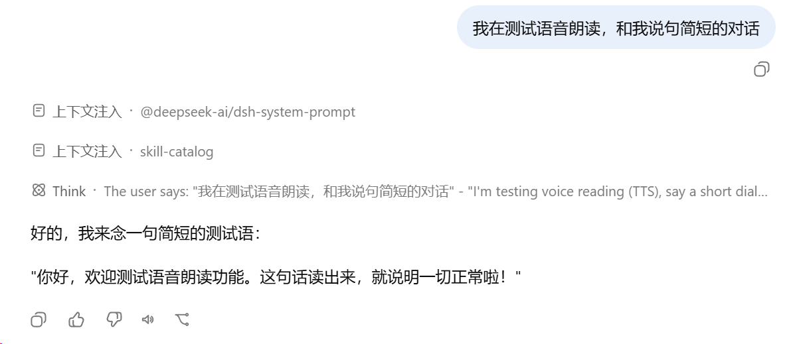
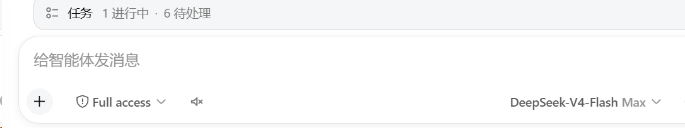
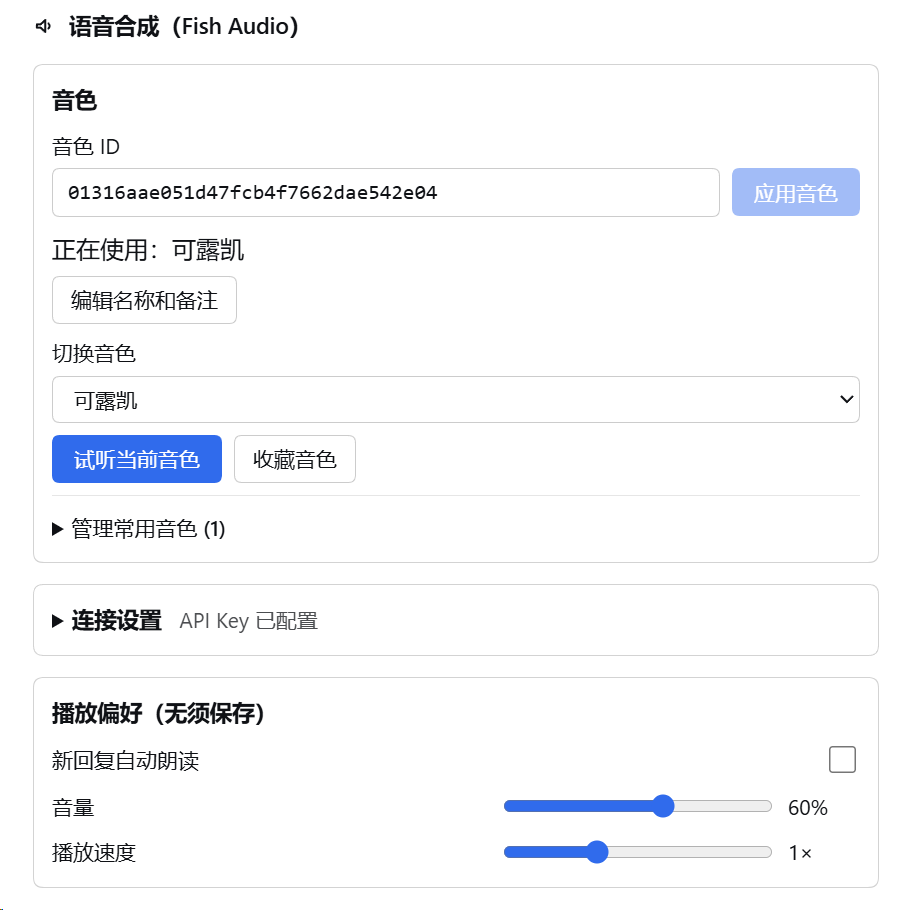

# dsh-fish-tts

**English | [中文](./README.md)**

<p align="center">
  
</p>

<p align="center">
  
  
  
</p>

A third-party **text-to-speech (TTS) plugin** for the
[DeepSeek Harness](https://github.com/deepseek-ai/deepseek-harness) (DSH) Web GUI:
one-click **read-aloud** for every assistant reply, an **auto-read** toggle in the
composer, and configurable model / voice / encrypted API key / proxy. **Fish Audio
API only — bring your own API key.** Works with any voice id (`reference_id`) you
are authorized to use, including voices you **cloned** on Fish Audio. The UI is
bilingual (English / 中文, follows the DSH locale).

### 30-second comparison vs. typical Edge TTS plugins

| | dsh-fish-tts (this plugin) | typical Edge TTS plugins |
| --- | --- | --- |
| Engine | **Fish Audio official API** (only; bring your own key) | Microsoft Edge built-in voices |
| Voice | Your own `reference_id` (incl. voices you cloned, must be authorized) | Fixed Edge voice library |
| API key | **Required** (AES-256-GCM encrypted in the settings page) | None |
| Best for | Users with a Fish Audio account who want their own or cloned voices | Quick free trials with fixed voices |

## Features

- **Read-aloud action**: every finalized assistant message gets a speaker button in its
  action strip (same icon style as the native actions). Click to synthesize and play that
  reply; **click the same message's button again while playing to stop** (no restart from
  the top), clicking another message's button switches playback straight over, and a
  second click while synthesis is still in flight cancels it. Markdown is
  cleaned before speaking: paths, URLs, long ids and code blocks are
  replaced with placeholders instead of being read out.
- **Auto-read**: a small speaker toggle in the composer tool row (synced with the settings
  page). When enabled, replies that arrive after the page loaded are read automatically.
- **Saved voices**: bookmark voice IDs with readable names and multiline notes, then select
  a name to switch immediately. Bookmarks stay on this machine; switching preserves other
  unsaved settings, and removing a bookmark does not clear the current voice.
- **Speech tool `fish_tts_speak`**: chat-channel agents (e.g. a QQ bot) can synthesize and
  deliver voice bubbles. Line cleaning, per-conversation rate limiting, server-side loudness
  normalization and the 24-hour audio file lifecycle all live in this plugin; Fish emotion
  and sound bracket tags (`[soft]`, `[laughing]`, …) pass through verbatim and are never
  read out. Channel plugins register a delivery hook through `ctx.fishTts.registerDelivery`;
  outbound filtering stays channel-side.
- **Settings page** (Settings → Voice (Fish TTS)):
  - TTS model (datalist suggestions + free text; e.g. s2.1-pro-free / s2.1-pro / s2-pro;
    saved values apply immediately; default s2.1-pro-free)
  - Voice `reference_id` (enter, edit or clear it directly without saving a bookmark;
    synthesis requires a valid ID, and the plugin ships no default voice)
  - API key (**AES-256-GCM encrypted** in `$DSH_HOME/fish-tts/settings.json` on this
    machine; `key.bin` is generated once and ACL-tightened on Windows; the key never
    appears in any GET response, log line or the repository)
  - HTTP proxy (e.g. `http://127.0.0.1:7890`, leave empty for direct)
  - Speech tool: enable toggle, format (mp3/wav/opus), max chars per line, max sends per
    minute (0 disables), server-side loudness normalization toggle, volume trim (-20..+20 dB)
  - Test / stop test playback, auto-read toggle, preview volume slider (default 60%,
    in-page only), playback-speed slider (0.5–2.0×, pitch-preserving; fixed at 1× where the
    browser lacks support)

## Screenshots

<p align="center">
  <br>
  <em>The "Read aloud" button in the message action strip</em>
</p>

<p align="center">
  <br>
  <em>The auto-read toggle in the composer tool row</em>
</p>

<p align="center">
  <br>
  <em>Apply a voice ID directly, switch saved voices by name and preview the active voice. Connection settings collapse; playback preferences need no save. The pictured voice is illustrative and is not bundled with the plugin.</em>
</p>

## Host and desktop compatibility

On 2026-09-30, the development team reported that `dsh-fish-tts 0.2.11` works with DSH `0.2.0-rc.2` and the desktop client of the same version. The plugin uses the Web client interface; its desktop UI does not require a separate desktop-specific package.

**0.2.12** adds English and Chinese names and descriptions to the plugin manager, following the client language. Synthesis and settings are unchanged. See [CHANGELOG.md](./CHANGELOG.md) for update notes.

Version **0.2.13** adds saved voices, redesigns the settings flow
and appearance, and fixes playback ownership, settings failure recovery and test feedback.
Stopping or switching cancels the browser request, but does not guarantee that
Fish has stopped processing it or charging for it.

This statement reflects maintainer usage feedback, not verification of every operating system or Fish model. Online synthesis still requires a valid API key, an available voice and network access. Host interface changes require renewed validation.

## Install

Desktop and Web have separate plugin installations and activation states. Choose the method matching your environment:

### Desktop Installation (Recommended)

Install directly within the desktop client UI (no command-line setup required):

1. Open **Plugins** in the desktop left sidebar, then click **Add plugin**;
2. Enter the npm package name `dsh-fish-tts@latest` and install;
3. Once installation completes, click **Enable now** (closing the dialog without enabling leaves the plugin installed but disabled);
4. Only if the UI indicates a restart is required, fully quit the application via the menu (**Quit**) and reopen it (closing the window may only hide it to the background);
5. Verification: Open **Settings** and confirm **Voice (Fish TTS)** appears in the settings sidebar.

<details>
<summary>Alternative: Desktop terminal installation (Windows / macOS)</summary>

If you prefer using the command line, use the desktop-bundled CLI:

1. In the desktop application menu, select **Manage dsh Command…** → **Install** (register the bundled CLI and follow any reported PATH conflict instructions), then open a new terminal;
2. Ensure the desktop app has been launched at least once to initialize, and fully exit via **Quit**;
3. Run the desktop-profile commands in your terminal to install and verify:
   ```sh
   dsh plugin --profile desktop add dsh-fish-tts@latest
   dsh plugin --profile desktop list
   ```
4. Reopen the desktop application.

> Note: Standalone `dsh` installed via npm or run via `npx` cannot manage the desktop profile. For details on how the bundled command runtime works, see [bundled-command-runtime](https://github.com/deepseek-ai/deepseek-harness/blob/dsh-v0.2.1-rc.2/apps/desktop/README.md#bundled-command-runtime) in the official desktop documentation.
</details>

### Web Installation

Manage Web plugins using the matching CLI. Prefer using the same host-matched `dsh` CLI that launches your Web instance:

```sh
dsh plugin --profile web add dsh-fish-tts@latest
```

Then **restart `dsh web`** (stop the process, run `dsh web` again), refresh the page, and open **Settings → Voice (Fish TTS)**.

Other install sources:

```sh
# From GitHub (the repository includes lib artifacts; no local build needed)
dsh plugin --profile web add github:MaRi23333/dsh-fish-tts

# From a local checkout
git clone https://github.com/MaRi23333/dsh-fish-tts.git
cd dsh-fish-tts
pnpm install && pnpm run build
dsh plugin --profile web add /absolute/path/to/dsh-fish-tts
```

> The repo commits `lib/` build artifacts, so git installs need no local build; after
> changing sources run `pnpm run build` and restart.

> **Note**: If using `npx`, pin it to the exact version matching your Web host (e.g. `npx @deepseek-ai/dsh@<version>`). When switching from the GitHub install to npm, a bare `add dsh-fish-tts` is a silent no-op when the git version is already installed (pnpm considers the same-name dependency satisfied). Use `dsh plugin --profile web add dsh-fish-tts@latest` instead, or `remove` first and then `add`.

> When installing a freshly published npm version, pnpm's supply-chain protection may
> automatically add `minimumReleaseAgeExclude: [dsh-fish-tts@…]` to the profile's
> `pnpm-workspace.yaml`. This is expected and harmless.

### Verify the install

1. Open **Settings → Voice (Fish TTS)**;
2. Enter your **API key** under **Connection settings**, then click **Save connection settings**;
3. Enter the voice **`reference_id`** under **Voice ID**, then click **Apply voice** (no name or bookmark required);
4. Click **Preview current voice** — hearing the test sentence in your voice means the install works.

> **Preview current voice** uses the saved voice and connection settings without saving any
> form drafts. It requests preview audio and calls the Fish Audio API when no cached result
> is available. A voice and an available key are required; pending or playing previews can be stopped.

### Save and switch your usual voices

**Voice ID** is always visible. Paste or edit it and click **Apply voice**, or empty the
field and click **Clear voice** to stop using the current voice. These actions update
only the current ID, require no bookmark and leave saved voices unchanged. Apply any
pending ID changes before previewing.

Bookmarks are optional shortcuts. A matching saved voice displays its name and note.
Select a name under **Switch voice** to switch immediately and update the ID field.
**Save voice** or **Name the current voice** opens a separate form for a name, ID and
optional note; **Add and use** saves and selects it. Existing voice IDs are preserved,
and up to 100 voices can be saved.

Expand **Manage saved voices** to use, edit or remove a voice. Editing changes only its
name and note without switching the active voice. Removal requires confirmation and
does not clear the current voice. Adding, editing and switching leave connection drafts
untouched. Connection settings have their own save button. Playback preferences need no
save button; volume and speed apply to subsequent read-aloud playback.

## Configuration

First run: open Settings → Voice (Fish TTS), save the connection settings (Fish Audio
API key, model and optional proxy), enter and apply a voice ID, then preview it. Saved settings
take effect immediately — no restart required.

You may also add a `config` to the `fish-tts` row in your profile's `cordis.patch.yml`
(settings-page values take precedence):

```yaml
- id: fish-tts
  config:
    model: s2.1-pro-free
    format: wav
    stateDir: /custom/state/dir
```

### Config keys

| Key | Default | Description |
| --- | --- | --- |
| `model` | `''` | Default model (settings-page value wins) |
| `voice` | `''` | Default voice reference_id (settings-page value wins) |
| `format` | `wav` | `wav` / `mp3` / `opus` / `pcm` |
| `apiKey` | `''` | Usually empty; the encrypted settings-page key wins, then env `FISH_API_KEY` |
| `apiKeyFile` | `''` | Read `FISH_API_KEY` from a dotenv file |
| `proxy` | `''` | HTTP(S) proxy (settings-page value wins) |
| `stateDir` | `$DSH_HOME/fish-tts` | Settings / key-file directory |

### Speech tool (fish_tts_speak)

For chat-channel plugins (e.g. a QQ bot): the model passes an utterance and this plugin
runs clean → synthesize → deliver. The channel registers a delivery hook in the host
context; outbound filtering and target-session resolution stay channel-side:

```ts
// inside the channel plugin (e.g. qqbot)
const fishTts = ctx.get('fishTts')
ctx.effect(() => fishTts.registerDelivery('qqbot', {
  // optional: claim the sessions this channel owns (omit to claim everything)
  claims: (sessionId, agent) => manager.findByAgent(agent) !== undefined,
  // outbound filter → throw on hit (nothing delivered) → resolve target → send voice
  deliver: async ({ audioPath, mime, text, sessionId, agent }) => { /* … */ },
}), 'qqbot: fish-tts delivery')
```

Contract highlights: input `{ text, voice?, format? }` (`voice` accepts a saved-voice
name or a raw reference_id); output carries sizes, format, MIME and delivery status
only — **no absolute paths, no spoken content**. Errors surface with code prefixes
(`rate-limited` / `text-too-long` / `auth` / `quota` / `network` / `voice-rejected`, …)
so the model can fall back to a text reply. The per-conversation per-minute limit
(default 1; 0 disables) claims the slot before synthesis and releases it on failure.
Undelivered audio stays in `$DSH_HOME/fish-tts/out/` and is swept after 24 hours.
Loudness normalization runs server-side at Fish Audio (`prosody.normalize_loudness`;
unsupported on s1 models), with a -20..+20 dB volume trim on top.

## Security

- The API key is persisted only in encrypted form (AES-256-GCM, per-machine random
  `key.bin`, 0600/ACL tightened) and never written to the repo, logs or any GET response.
- Write routes (synthesize/config) require `application/json` and validate
  same-origin/loopback `Origin`, blocking cross-site form abuse.
- **Local-only**: every `/fish-tts/*` route rejects non-loopback peers
  (127.0.0.1 / ::1 / ::ffff:127.0.0.1) with 403, even if the host listens on 0.0.0.0.
- **Proxy URLs with username/password are refused** on save; credentialed
  `HTTPS_PROXY`/`HTTP_PROXY` env vars are likewise ignored (no leak, no fallback) —
  use a credential-less proxy or direct connection.
- Proxy addresses, models and voices are machine-local user settings; the repo carries
  no personal data.
- Synthesis text is capped at 12000 characters; results are cached in-process
  (max 200 entries), cleared on restart.
- Speech-tool results carry sizes, format and delivery status only — no absolute paths,
  spoken lines or identity data; generated audio stays in `$DSH_HOME/fish-tts/out/` on
  this machine, and logs record byte/char counts only.

## Develop

```sh
pnpm install
pnpm run typecheck
pnpm run test       # node:test suite (upstream Fish API is locally mocked, no network)
pnpm run build      # host: lib/index.js; client: lib/client.js (ModuleLoader CJS closure)
pnpm run smoke      # host entry + client ModuleLoader smoke tests
pnpm run check:pack # npm pack content whitelist check
```

> Requires Node >= 22 (Node 20 is EOL). CI (`.github/workflows/ci.yml`) runs the full
> gate chain on Node 22 and 24 and verifies `lib/` artifacts match the committed ones.

- Host side lives in `src/index.ts` (Node; registers the `/fish-tts/*` routes and the
  settings store).
- Client side lives in `src/client/` (React; registers the
  `conversation.chat.assistant-actions`, `conversation.input.left` and
  `settings.section` slots).
- Development dependencies and CI type checks still use the DSH `0.1.2-rc.1` baseline, retaining its session API and UI icon adaptations. See "Host and desktop compatibility" above for current usage feedback;
  if the API drifts on other versions, align
  with the matching tag of the [deepseek-harness repo](https://github.com/deepseek-ai/deepseek-harness).

## License

[MIT](./LICENSE)

### Compliance & Third-Party Notice

- This is a **third-party open-source plugin**, not affiliated with, sponsored, or endorsed by Fish Audio / Hanabi AI Inc. "Fish Audio" is a trademark of its owner and is used here descriptively only.
- The plugin **does not distribute or host API keys** — use your own Fish Audio account and key, and keep it safe.
- Fish Audio's **free tier is for personal, non-commercial use only**; commercial use requires a paid plan. See the [Terms of Use](https://fish.audio/terms).
- Only use voices (reference_id) you are authorized to use. Do not clone or imitate the voice of public figures, celebrities, or private individuals without permission. See the [Acceptable Use Policy](https://fishaudio.org/zh/acceptable-use).
- When distributing generated audio, disclose that it is AI-synthesized; do not mislead listeners into believing it is a real human recording.
- Using this plugin means you agree to Fish Audio's terms; the official pages prevail if updated.

---

*Independent community project — not affiliated with or endorsed by DeepSeek.*
